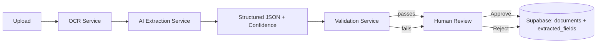

# AI-Powered Smart Data Entry System

A human-in-the-loop document intelligence platform that turns invoices, receipts, purchase orders, and customer forms into structured, validated data — with AI doing the first pass and a human doing the final check.

**Live demo:** deploy `index.html` to GitHub Pages and it runs fully in **Demo Mode**, no backend required. See [Demo Mode](#demo-mode).

---

## Table of Contents

- [Description](#description)
- [Features](#features)
- [Architecture](#architecture)
- [Tech Stack](#tech-stack)
- [Project Structure](#project-structure)
- [Local Installation](#local-installation)
- [Environment Variables](#environment-variables)
- [Supabase Setup](#supabase-setup)
- [Backend Setup](#backend-setup)
- [Frontend Setup](#frontend-setup)
- [GitHub Pages Deployment](#github-pages-deployment)
- [Backend Deployment](#backend-deployment)
- [Supabase Deployment](#supabase-deployment)
- [API Documentation](#api-documentation)
- [AI Configuration](#ai-configuration)
- [Demo Mode](#demo-mode)
- [Security](#security)
- [Future Improvements](#future-improvements)
- [License](#license)

---

## Description

Manual data entry — retyping invoice numbers, totals, and customer details from scanned documents into a system of record — is slow and error-prone. This project automates the *first pass* with OCR and AI extraction, but never lets AI output reach the database unchecked.

Every document goes through the same pipeline:

1. A person uploads a document.
2. OCR turns the image/PDF into raw text.
3. An AI extraction layer turns that text into structured fields with a confidence score per field.
4. A rule-based validation layer — independent of the AI — checks formats, required fields, and cross-field math (e.g. `quantity × unit_price == total`).
5. Low-confidence or invalid fields are flagged for **human review**.
6. A person edits and approves the record before it's considered final.

That last step is the point: this is a **human-in-the-loop** system. The AI assists the operator; it doesn't replace their judgment.

## Features

- Drag-and-drop upload for PDF, JPG, and PNG documents
- OCR text extraction (pluggable provider, defaults to a local/offline option)
- AI field extraction into structured JSON, with a confidence score per field
- Rule-based validation independent of the AI (required fields, email format, non-negative quantities, total reconciliation)
- Human review workspace: document preview, editable extracted fields, inline validation errors, Approve / Reject / Save Draft
- Dashboard: total/processed/pending/approved documents, average confidence, processing success rate, recent activity, items needing attention
- Documents list with search, status/type filters, and sortable columns
- Document-template system (Invoice, Receipt, Customer Form, Purchase Order, General Document) that's easy to extend
- Analytics view: approval rate, manual correction rate, failure rate, most common document types
- Fully responsive, accessible UI (semantic HTML, visible focus states, no color-only status indicators)
- **Demo Mode** — the entire app runs against mock data and localStorage with zero backend, for portfolio demos on GitHub Pages

## Architecture

```
                 GitHub Pages
                      │
                      ▼
         Static Frontend (HTML/CSS/JS)
        index.html + js/*.js + css/*.css
                      │
                      │  HTTPS  (fetch, centralized in js/api.js)
                      ▼
          Python FastAPI Backend
        (Render / Railway / Fly.io / etc.)
                      │
        ┌─────────────┼──────────────┐
        ▼             ▼              ▼
   OCRService   AIExtractionService  ValidationService
  (pluggable)     (pluggable)        (rule-based)
        │             │
        └──────┬──────┘
               ▼
          Supabase
      (PostgreSQL + Storage + Auth)
```

Backend request flow:

```
Routes  →  Services  →  Business Logic  →  Database
(FastAPI)   (OCR/AI/     (validation,      (Supabase
             Validation)  status transitions) Postgres)
```

The AI and OCR layers are behind small abstractions (`AIExtractionService`, `OCRService`) specifically so a new provider can be swapped in by adding one class — nothing in `routes/` needs to change.

### Mermaid diagram



## Tech Stack

| Layer | Technology |
|---|---|
| Frontend | HTML5, CSS3, vanilla JavaScript (no framework, no build step) |
| Backend | Python, FastAPI |
| Database | Supabase (PostgreSQL) |
| Auth (optional) | Supabase Authentication |
| Storage | Supabase Storage |
| OCR | Pluggable — local Tesseract by default, mock provider for demos |
| AI extraction | Pluggable — Anthropic API by default, mock provider for demos |

## Project Structure

```
AI-Powered-Smart-Data-Entry-System/
│
├── index.html                  # Single entry point — required for GitHub Pages
├── README.md
├── .gitignore
│
├── css/
│   ├── style.css                # Design tokens, layout, shared components
│   ├── dashboard.css             # Dashboard/analytics/templates-specific styles
│   └── responsive.css            # @media breakpoints (tablet, mobile, reduced motion)
│
├── js/
│   ├── api.js                    # Centralized API_BASE_URL + fetch wrapper + demo-mode detection
│   ├── store.js                  # localStorage-backed mock "database" used in Demo Mode
│   ├── ui.js                     # Toasts, badges, the confidence indicator, formatters
│   ├── validation.js             # Client-side rule-based validation (mirrors backend)
│   ├── upload.js                 # Drag-and-drop + the demo processing pipeline
│   ├── dashboard.js              # Dashboard stats + charts
│   ├── documents.js               # Documents list: search/filter/sort
│   ├── review.js                  # Human review workspace (the "Data Entry" view)
│   ├── templates.js               # Template library view
│   ├── analytics.js               # Analytics view
│   └── app.js                     # Router / view switching / boot sequence
│
├── assets/                       # Icons / images (none required — emoji used as icons)
│
├── backend/
│   ├── app/
│   │   ├── main.py                # FastAPI app, CORS, global error handler, health check
│   │   ├── config.py              # Settings loaded from environment variables
│   │   ├── routes/
│   │   │   ├── documents.py       # Upload, process, fields, approve, reject
│   │   │   ├── dashboard.py       # Aggregate stats
│   │   │   └── templates.py       # Document-template definitions
│   │   ├── services/
│   │   │   ├── ocr_service.py             # OCRService abstraction (Tesseract / mock)
│   │   │   ├── ai_extraction_service.py   # AIExtractionService abstraction (Anthropic / mock)
│   │   │   ├── validation_service.py      # Rule-based validation, independent of AI
│   │   │   └── supabase_service.py        # Supabase client (service-role key, backend only)
│   │   ├── models/
│   │   │   └── document.py        # Table names + status/stage vocabulary
│   │   ├── schemas/
│   │   │   ├── document.py        # Pydantic request/response models
│   │   │   ├── field.py
│   │   │   └── dashboard.py
│   │   └── utils/
│   │       ├── logger.py
│   │       └── file_utils.py
│   ├── requirements.txt
│   └── .env.example
│
└── database/
    └── schema.sql                 # documents, extracted_fields, processing_logs, document_templates
```

## Local Installation

```bash
git clone https://github.com/your-username/AI-Powered-Smart-Data-Entry-System.git
cd AI-Powered-Smart-Data-Entry-System
```

You now have two independent pieces to run: the static frontend and (optionally) the FastAPI backend. The frontend works on its own in **Demo Mode** — you don't need the backend to explore the app.

## Environment Variables

Backend configuration lives in `backend/.env`, based on `backend/.env.example`:

```bash
cd backend
cp .env.example .env
```

| Variable | Frontend-safe? | Description |
|---|---|---|
| `APP_ENV` | — | `development` or `production` |
| `DEMO_MODE` | — | `true` runs OCR/AI with mock providers, no external calls |
| `ALLOWED_ORIGINS` | — | Comma-separated origins allowed by CORS (your GitHub Pages URL) |
| `SUPABASE_URL` | ✅ Yes | Project URL |
| `SUPABASE_ANON_KEY` | ✅ Yes | Public anon key — safe to expose, restricted by Row Level Security |
| `SUPABASE_SERVICE_ROLE_KEY` | ❌ **No — server only** | Bypasses RLS. Never send to the browser, never commit it |
| `AI_PROVIDER` | — | `anthropic` \| `openai` \| `mock` |
| `AI_API_KEY` | ❌ **No — server only** | Used by `AIExtractionService`, never exposed to the frontend |
| `OCR_PROVIDER` | — | `tesseract` \| `mock` \| `external` |
| `SUPABASE_STORAGE_BUCKET` | — | Bucket name for uploaded source files |
| `MAX_UPLOAD_SIZE_MB` | — | Upload size limit |

The frontend has **no `.env` file** — its only configuration is `PRODUCTION_API_BASE_URL` inside `js/api.js`, since GitHub Pages serves plain static files.

## Supabase Setup

1. Create a project at [supabase.com](https://supabase.com).
2. Open the SQL editor and run `database/schema.sql`. This creates the `documents`, `extracted_fields`, `processing_logs`, and `document_templates` tables, plus Row Level Security policies.
3. Under **Storage**, create a bucket named `documents` (or match whatever you set as `SUPABASE_STORAGE_BUCKET`).
4. (Optional) Enable **Authentication** if you want per-user document ownership — the schema already includes an `uploaded_by` column and RLS policies keyed to `auth.uid()`. Skip this for a single-operator demo.
5. From **Project Settings → API**, copy the Project URL, `anon` public key, and `service_role` key into `backend/.env`.
6. Restart the backend so it picks up the new environment variables.

## Backend Setup

Use Python 3.11 or newer for the backend runtime. The project has been tested with recent Python versions, including 3.14, and the pinned dependency ranges are kept compatible with the current interpreter.

```bash
cd backend
python3 -m venv venv
source venv/bin/activate        # Windows: venv\Scripts\activate
pip install -r requirements.txt
cp .env.example .env            # then fill in your values
uvicorn app.main:app --reload --port 8000
```

The API is now available at `http://localhost:8000/api`, with interactive docs at `http://localhost:8000/docs`.

> **Note on OCR:** the default `tesseract` provider requires the `tesseract-ocr` system package (`apt install tesseract-ocr` / `brew install tesseract`). If it isn't installed, set `OCR_PROVIDER=mock` or `DEMO_MODE=true` in `.env` — the app runs the identical pipeline with mock text instead of failing.

## Frontend Setup

The frontend is static HTML/CSS/JS — no build step, no `npm install`. Open `index.html` directly, or serve it with any static file server for a more realistic environment (some browsers restrict `fetch()` from `file://` origins):

```bash
# from the project root
python3 -m http.server 5500
# then open http://localhost:5500
```

By default, on `localhost` the frontend points at `http://localhost:8000/api` (see `js/api.js`). If that backend isn't running, the app automatically falls back to **Demo Mode** — you'll see a "Demo Mode" pill in the sidebar and everything still works against mock data.

To force Demo Mode regardless of backend availability, open `index.html?demo=1`.

## GitHub Pages Deployment

GitHub Pages hosts **only the static frontend** — it cannot run the FastAPI backend.

1. Push this repository to GitHub.
2. In your repo, go to **Settings → Pages**.
3. Under **Build and deployment**, choose **Deploy from a branch**, select your default branch, and set the folder to `/ (root)` — since `index.html` is already at the project root.
4. Save. GitHub Pages will publish at `https://your-username.github.io/AI-Powered-Smart-Data-Entry-System/`.
5. Update `PRODUCTION_API_BASE_URL` in `js/api.js` to point at your deployed backend (see below), then commit and push — GitHub Pages redeploys automatically.

Without a deployed backend, the published site still works end-to-end in Demo Mode, which is enough for a portfolio walkthrough.

## Backend Deployment

The FastAPI backend needs a host that runs a persistent Python process — GitHub Pages can't do this. Two straightforward options:

**Render**
1. Create a new **Web Service**, connect this repo, and set the root directory to `backend/`.
2. Build command: `pip install -r requirements.txt`
3. Start command: `uvicorn app.main:app --host 0.0.0.0 --port $PORT`
4. Add the environment variables from `backend/.env.example` under **Environment**.

**Railway**
1. Create a new project from this repo, root directory `backend/`.
2. Railway auto-detects the `Procfile`-less Python app; set the start command to `uvicorn app.main:app --host 0.0.0.0 --port $PORT`.
3. Add the same environment variables under **Variables**.

Either platform works well for a small FastAPI service; Render's free tier is a reasonable default for a portfolio project. Whichever you choose, set `ALLOWED_ORIGINS` to your GitHub Pages URL so CORS allows the deployed frontend to call the API.

## Supabase Deployment

Supabase *is* the production database — there's no separate "deploy" step beyond the setup above. Supabase hosts the PostgreSQL instance, file storage, and (optionally) authentication; your FastAPI backend connects to it over the internet using the service-role key, from wherever the backend is deployed.

> If you outgrow Supabase's managed Postgres (e.g. very high write volume, need for on-prem hosting), the swap-out point is `services/supabase_service.py` — everything else references tables through `models/document.py` constants, not Supabase-specific query syntax, so migrating to a self-hosted Postgres + an ORM like SQLAlchemy is a contained change.

## API Documentation

All endpoints are prefixed with `/api`. Interactive Swagger docs are available at `/docs` when the backend is running.

| Method | Endpoint | Description |
|---|---|---|
| GET | `/api/health` | Backend liveness check (used by the frontend to detect Demo Mode) |
| POST | `/api/documents/upload` | Upload a file (multipart/form-data) |
| GET | `/api/documents` | List all documents |
| GET | `/api/documents/{id}` | Get one document |
| POST | `/api/documents/{id}/process` | Run OCR → AI extraction → validation |
| GET | `/api/documents/{id}/fields` | Get extracted fields for a document |
| PUT | `/api/documents/{id}/fields` | Save human-edited field values |
| POST | `/api/documents/{id}/approve` | Approve (blocked if validation errors remain) |
| POST | `/api/documents/{id}/reject` | Reject |
| GET | `/api/dashboard/stats` | Aggregate dashboard statistics |
| GET | `/api/templates` | List document templates |
| GET | `/api/templates/{id}` | Get one template |

## AI Configuration

`AIExtractionService` (in `backend/app/services/ai_extraction_service.py`) is provider-independent by design:

- `AI_PROVIDER=mock` (default when `DEMO_MODE=true`) — generates plausible field values with varied confidence scores, no API key needed.
- `AI_PROVIDER=anthropic` — calls the Anthropic Messages API using `AI_API_KEY` and `AI_MODEL`, with a prompt built from the document's template field schema, requesting structured JSON back.

To add another provider (OpenAI, a local model, etc.), implement `BaseAIProvider.extract()` and register it in `AIExtractionService._build_provider` — no other file needs to change.

**The AI API key never leaves the backend.** It is read from the environment and used only inside `ai_extraction_service.py`; it is never included in any response sent to the frontend.

## Demo Mode

Demo Mode lets the entire application — dashboard, documents, upload, human review, templates, analytics — run with zero backend, zero database, and zero API keys, which is exactly what you want for a portfolio link.

**Frontend:** `js/api.js` pings `/api/health` on load. If that fails (or you add `?demo=1` to the URL), `js/store.js` takes over as an in-browser "database," seeded with sample documents at a range of statuses and confidence scores, persisted to `localStorage`. Uploading a new file runs a simulated OCR → AI extraction → validation pipeline (`js/upload.js`) with realistic timing and randomized confidence scores, so the review workflow behaves the same way it would against a real backend.

**Backend:** setting `DEMO_MODE=true` (the `.env.example` default) makes `OCRService` and `AIExtractionService` use their mock providers instead of calling Tesseract or the Anthropic API — useful for running the *real* FastAPI + Supabase stack without paid AI/OCR credentials yet.

Demo behavior is never presented as production behavior: the sidebar always shows a **Demo Mode** pill when running against mock data, and mock provider responses are logged clearly (`MockOCRProvider`, `MockAIProvider`) rather than silently pretending to be real extraction.

## Security

- `SUPABASE_SERVICE_ROLE_KEY`, `AI_API_KEY`, and all other backend secrets live only in `backend/.env` (gitignored) or your hosting platform's environment variable settings — never in frontend code, never committed.
- The frontend only ever uses `SUPABASE_URL` and `SUPABASE_ANON_KEY` if it talks to Supabase directly — in this architecture it doesn't; all Supabase access goes through the FastAPI backend using the service-role key.
- The global exception handler in `main.py` catches every unhandled error and returns a generic message — stack traces and internal details are logged server-side only, never sent to the client.
- CORS is restricted to `ALLOWED_ORIGINS`, not left wide open.
- File uploads are validated by extension and MIME type, and capped at `MAX_UPLOAD_SIZE_MB`.
- A document cannot be approved while blocking validation errors remain (enforced on both the frontend and the backend, so the check can't be bypassed by calling the API directly).

## Future Improvements

- Additional document templates (contracts, ID documents, insurance claims)
- Higher-accuracy OCR provider integration (e.g. cloud OCR with layout awareness)
- Multi-language OCR and extraction
- A UI for building custom templates instead of editing `routes/templates.py`
- Fine-tuning or few-shot calibration of the AI extraction model per document type
- Batch upload and batch approval
- CSV / Excel export of approved records
- Role-based access control (operator vs. reviewer vs. admin)
- Full audit log viewer backed by the `processing_logs` table
- Deeper analytics (time-to-approval, per-operator correction rates)

## License

Released under the [MIT License](https://opensource.org/licenses/MIT). You're free to use, modify, and distribute this project, including for portfolio and commercial purposes, with attribution.
